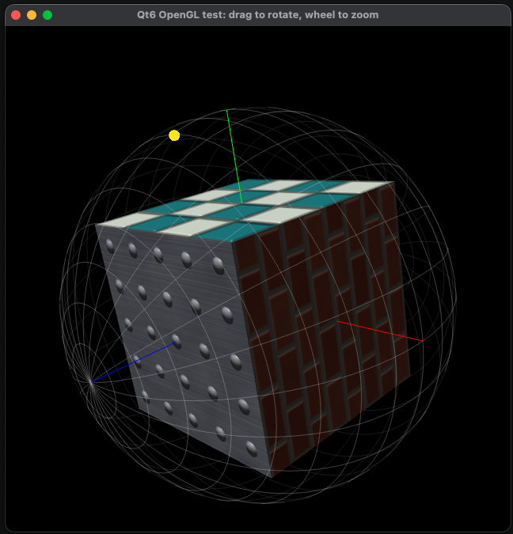
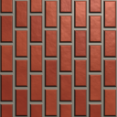
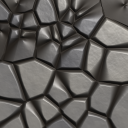
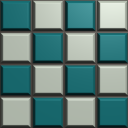
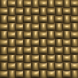
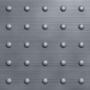
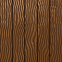

# Qt6 OpenGL Test

A small Python program for testing OpenGL inside a Qt6 window. It draws a
textured, bump-mapped cube inside a latitude/longitude sphere grid, and you can
rotate, zoom and pan the scene and move the light with the mouse.

All the textures are generated in code, so the program loads no image files.



## What it draws

- **Cube:** a 2x2x2 cube centred on the origin, with a different material on
  each side.

  | Side | Direction | Material | As drawn |
  |---|---|---|---|
  | Right | +X | Brick |  |
  | Left | −X | Cobblestone |  |
  | Top | +Y | Glazed teal and cream tiles |  |
  | Bottom | −Y | Woven straw |  |
  | Front | +Z | Riveted brushed metal |  |
  | Back | −Z | Wooden planks |  |

  Each face is shown head-on under the default light, as rendered by the
  program's cube renderer. `tools/make_face_images.py` makes the images;
  rerun it after changing a material, the cube shader or the default light:

  ```
  python3 tools/make_face_images.py docs/images
  ```

- **Sphere grid:** lines every 15° of longitude and 10° of latitude, drawn at
  30% opacity and fixed to the cube. Near-side lines are light gray and far-side
  lines are dark gray.
- **Axes:** the +X, +Y and +Z axes are red, green and blue lines running from
  the origin to the sphere. The cube hides the parts inside it.
- **Light dot:** a yellow dot on the sphere marks the direction to the light. It
  appears faintly when it is behind the cube.

### Sphere coordinates

| Direction | Latitude | Longitude |
|---|---|---|
| +X | 0° | 0° |
| +Y | 0° | +90° |
| +Z | +90° (pole) | Any |
| −Z | −90° (pole) | Any |

## Requirements

- Python 3.10 or later; 3.12 is the version developed against
- PyQt6, including the `QtOpenGLWidgets` module
- PyOpenGL
- NumPy
- OpenGL 3.1 or later, or OpenGL ES 3.0 or later, and a display

## Setting up

### Python environment

The repository pins its Python dependencies in two conda files for
[miniforge](https://github.com/conda-forge/miniforge). `environment.yml` is
the minimum to run and develop the program; `environment-docs.yml` layers the
Sphinx tooling on top:

```
conda env create -f environment.yml
conda activate opengl_qt6_test
conda env update -n opengl_qt6_test -f environment-docs.yml   # only for the docs
```

Everything comes from conda-forge, so Qt is installed once and PyQt6 is built
against it. Do not `pip install PyQt6` into that environment; the wheel
bundles a second copy of Qt.

On Debian and Raspberry Pi OS the system packages are enough to run it, and
are what the Pi has been tested with. `apt-packages.txt` lists them with
comments, and `apt-packages-docs.txt` adds the system tools for the manual:

```
sudo apt install $(sed 's/#.*//' apt-packages.txt)
sudo apt install $(sed 's/#.*//' apt-packages-docs.txt)   # only for the docs
```

Ruff and the Sphinx packages are not taken from apt there: Ruff is only in
Debian unstable, Bookworm's Sphinx stack is below the floors in
`docs/requirements.txt`, and both Bookworm and Trixie ship the PlantUML
Sphinx extension at a 2014 release. Put them in a venv that can still see
apt's PyQt6, which the docs build imports:

```
python3 -m venv --system-site-packages .venv
. .venv/bin/activate
pip install ruff -r docs/requirements.txt
```

### Raspberry Pi OS versus Debian

Raspberry Pi OS is Debian with its own kernel, firmware and desktop, so the
package names and versions in the two lists above are the same on both:
Pi OS Bookworm is Debian 12 and Pi OS Trixie is Debian 13. The differences
that matter here:

- **What is already installed.** Pi OS desktop ships Mesa with the V3D
  driver, a Wayland session (Wayfire on Bookworm, labwc on Trixie) and NumPy,
  so most of `apt-packages.txt` is a no-op there. A minimal Debian install
  needs the lot, plus a desktop session to give the program a display.
- **GPU stack.** Pi OS enables the `vc4-kms-v3d` overlay and ships Pi
  firmware; that is what makes OpenGL 3.1 and OpenGL ES 3.1 appear. Vanilla
  Debian on a Pi has to provide the same kernel driver and firmware itself,
  and Debian's support for the Pi 5 is still partial.
- **32-bit.** Pi OS still offers a 32-bit (armhf) image. All the apt packages
  exist for armhf, but conda-forge does not build for it, so the
  `environment.yml` route is 64-bit only.
- **Pi OS's own archive** overlays Debian's with Pi-specific builds of the
  graphics stack and desktop. Nothing in the lists above comes from it, but
  `libgl1-mesa-dri` may resolve to a Pi build there rather than Debian's.

### System prerequisites

These are not Python packages, so neither environment file installs them. On
macOS they come from MacPorts; on Debian-based systems from apt.

| Needed for | What | macOS (MacPorts) | Debian / Raspberry Pi OS (apt) |
|------------|------|------------------|--------------------------------|
| Running | OpenGL driver and a display | Built in; Apple's OpenGL 4.1 | Mesa, preinstalled on Pi OS; a Wayland or X11 session |
| Docs | `make` | Xcode command line tools | `make` |
| Docs | PlantUML launcher and jar | `sudo port install plantuml` | `sudo apt install plantuml` |
| Docs | Java runtime, for PlantUML | `sudo port install openjdk21`, or any JDK that `/usr/libexec/java_home` can find | pulled in by the `plantuml` package |
| Docs | Graphviz `dot`, for the class and call-graph diagrams | `sudo port install graphviz` | `sudo apt install graphviz` |

The MacPorts `plantuml` launcher is a shell script that runs whichever `java`
is on the PATH, and Apple's `/usr/bin/java` is only a stub until a JDK is
installed. Keep Graphviz out of the conda environment: conda-forge's Graphviz
13 produces SVG that PlantUML rejects, and `docs/conf.py` points PlantUML at
`/opt/local/bin/dot` when it exists for that reason.

### OpenGL versions

`main.py` asks each platform for the newest OpenGL it offers, and the shaders
are compiled under the matching GLSL version. On Linux it requests OpenGL ES
3.1, which on a Raspberry Pi 5 is the native path of Mesa's V3D driver. On
macOS it requests an OpenGL 4.1 core profile, because macOS has no OpenGL ES
and offers only OpenGL 2.1 otherwise. The shader source is the same on both;
only the `#version` line differs, and it is chosen at run time from the
context that was actually created, so a platform that grants less than was
requested still works.

The program has been run on a Raspberry Pi with a V3D 7.1 GPU, under Wayland,
using both OpenGL 3.1 and OpenGL ES from Mesa, and on an Apple M4 using
OpenGL 4.1 core. Apple's core profile ignores line widths above one pixel, so
the axes draw thinner there than on the Pi.

## Running

Run these commands from this directory:

```
python3 src/main.py           # open the window
python3 src/main.py --check   # run the self-test, then exit
```

The self-test opens the window for a few seconds, so it needs a display. It
simulates mouse input, prints `PASS` or `FAIL` for each check, and exits with
status 0 only if everything passed.

## Testing

Run the test suite from this directory:

```
pytest
```

It renders into an offscreen OpenGL context, so like `--check` it needs a
display. The suite fails if coverage of `src` drops below 100%. The test
packages (`pytest`, `pytest-cov`, `pytest-qt`) come from `environment.yml`
under conda or from `apt-packages.txt` on Debian.

The coverage gate applies to the full run, so run a subset with
`pytest --no-cov tests/test_<module>.py`.

## Mouse controls

| Input | Action |
|---|---|
| Left-drag | Rotate the cube and sphere |
| Right-drag | Move the light |
| Middle-drag | Pan |
| Wheel | Zoom |
| Double-click | Reset the view and the light |

The light stays fixed in the scene, so its dot doesn't move when you rotate the
cube.

## Icon

`icon.png` is the application icon, which Qt shows in the Dock or taskbar
while the program runs. It is cropped from a screenshot of the window by
`tools/make_icon.py`, which finds the sphere, masks it to a disc and scales it
to 512 pixels. To regenerate it from a new screenshot:

```
python3 tools/make_icon.py tools/ScreenGrab.png icon.png
```

## Configuration

Settings such as colours, opacity, grid spacing, bump depth and mouse sensitivity
are in `src/config.py`.

## Documentation

The manual for the latest release is published at
<https://esba1ley.github.io/opengl_python_qt6_test/>.

An HTML manual, built with Sphinx in the Read the Docs style, combines this
file, `src/README.md`, PlantUML diagrams of how the program executes, an API
reference generated from the docstrings, and a page per test file saying what
each test checks and why. It needs the Sphinx packages from
`environment-docs.yml` (or `docs/requirements.txt` for pip) and the PlantUML,
Java and Graphviz entries from the system prerequisites table above.

```
make -C docs html
open docs/_build/html/index.html
```

`.github/workflows/docs.yml` builds the same manual on GitHub for every push
to `develop`, `main` and the `ft/` and `rc/` branches, with warnings as errors, and publishes it from `main`
only, so the site changes with each release.

## Code layout

The code is in `src/`. See [`src/README.md`](src/README.md) for how the
modules fit together.
