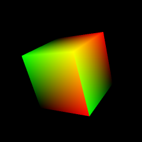
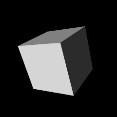
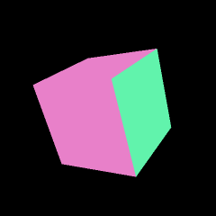
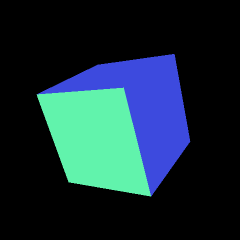
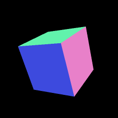

# The geometry

Everything the program draws is built from points listed in
{py:mod}`geometry`: the cube's 36 vertices, and the lines and the point of
the overlay. This page explains how each list is made and what every number
in a vertex means. All of it is in model space, the frame of
{ref}`the chain of spaces <guide-spaces-chain>`, except the light dot.
[The next page](buffers.md) uploads the lists to the GPU.

(guide-cube-faces)=
## The cube

The cube spans $-1$ to $1$ on each axis, so it is 2 units wide and its
corners are $\sqrt{3} \approx 1.732$ from the origin. Its six faces are
listed in `geometry.CUBE_FACES`:

```{literalinclude} ../../src/geometry.py
:language: python
:start-after: FLOATS_PER_VERTEX =
:end-before: def cube_vertices
```

Each entry names a face by its outward normal: `axis` is 0, 1 or 2 for $x$,
$y$ or $z$, and `sign` says which end. A face's position in the tuple is its
index, 0 to 5, and that index is also its texture layer
({ref}`guide-layers`).

{py:func}`geometry.cube_vertices` turns the table into vertices:

```{literalinclude} ../../src/geometry.py
:language: python
:pyobject: cube_vertices
:start-at: data = []
:dedent: 4
```

For each face:

- **Axes.** `u, v` are the two axes other than `axis`, in increasing order.
  The face's normal is `sign` along `axis`. Its **tangent** is $+1$ along
  `u`, the direction in which the texture coordinate $u$ grows, and its
  **bitangent** is $+1$ along `v`, the direction in which $v$ grows. The
  three are unit vectors at right angles.
- **Corners.** Each corner is `sign` along the normal's axis and $a$, $b$
  along the tangent and bitangent axes, for $(a, b)$ = $(-1, -1)$,
  $(1, -1)$, $(1, 1)$, $(-1, 1)$: once round the face, anticlockwise in the
  $(a, b)$ plane, starting at the corner where both are $-1$.
- **Texture coordinates.** A corner gets
  $(u, v) = \bigl(\tfrac{a + 1}{2},\ \tfrac{b + 1}{2}\bigr)$, which maps
  $[-1, 1]$ onto $[0, 1]$, so the whole texture covers the face once.
- **Triangles.** The GPU draws triangles, not squares. The indices
  `(0, 1, 2, 0, 2, 3)` make two triangles that share the diagonal from
  corner 0 to corner 2. Corners 0 and 2 are written twice, so each face has
  six vertices.
- **One vertex.** Every vertex gets 15 floats: position, normal, tangent,
  bitangent, $u$, $v$ and the layer.

Six faces of six vertices make 36 vertices, 12 triangles, and
$36 \times 15 = 540$ floats. The first face, +X (layer 0), comes out as:

| Vertex | Corner | Position | $(u, v)$ |
|---|---|---|---|
| 0 | 0 | $(1, -1, -1)$ | $(0, 0)$ |
| 1 | 1 | $(1, 1, -1)$ | $(1, 0)$ |
| 2 | 2 | $(1, 1, 1)$ | $(1, 1)$ |
| 3 | 0 | $(1, -1, -1)$ | $(0, 0)$ |
| 4 | 2 | $(1, 1, 1)$ | $(1, 1)$ |
| 5 | 3 | $(1, -1, 1)$ | $(0, 1)$ |

with normal $(1, 0, 0)$, tangent $(0, 1, 0)$ and bitangent $(0, 0, 1)$ on all
six. Which axes each face gets, and how the textures therefore appear turned
or mirrored on the cube, is in
{ref}`how u and v land on the cube <guide-uv-on-cube>`.

A corner of the cube belongs to three faces, but it is stored separately for
each, because each face gives it a different normal, tangent, bitangent,
texture coordinate and layer. A vertex is the whole set of 15 numbers, not
just the position.

Anticlockwise in $(a, b)$ is anticlockwise as seen from outside only on the
faces where tangent × bitangent points outwards. That would matter if the
program culled faces by their winding order, which it does not: the depth
test alone hides the back faces.

(guide-layers)=
## Which layer each vertex uses

Every vertex of the cube carries $3 + 3 + 3 + 3 + 2 + 1 = 15$ floats
(`geometry.FLOATS_PER_VERTEX`), described by `geometry.VERTEX_ATTRIBUTES`:

```{literalinclude} ../../src/geometry.py
:language: python
:start-at: VERTEX_ATTRIBUTES = (
:end-at: FLOATS_PER_VERTEX =
```

{py:func}`geometry.cube_vertices` writes each face's six vertices (two
triangles) with the face's index in `CUBE_FACES` as the `layer`, as a float. The
order of `CUBE_FACES`, $+X, -X, +Y, -Y, +Z, -Z$, matches the order of
`textures.MATERIALS`, so layer 0 is the bricks on +X, and so on
({ref}`how u and v land on the cube <guide-uv-on-cube>` has the table). {py:meth}`cube.CubeRenderer.init_vertices`
connects each attribute to the shader input of the same name, in this order
([from arrays to vertex buffers](buffers.md)).

The vertex shader passes the layer on as a `flat` output, so the fragment
shader receives exactly the value written for the vertex instead of an
interpolated one. Every vertex of a face has the same layer, so nothing is
lost, and no rounding can land between two layers.

(guide-geometry-views)=
## Seeing the vertex data: the geometry debug views

The cube shader has five debug views that draw the per-vertex inputs instead
of the lit colour ([the debug views](shaders.md#the-debug-views) on the
shaders page lists them all):

```{literalinclude} ../../src/shaders.py
:language: glsl
:dedent: 4
:start-at: else if (view == 6)
:end-at: else if (view == 10)
```

Each writes a colour from one input, after the vertex shader has rotated the
directions into world space and the GPU has interpolated them across the
face. The images show the cube at the default rotation, so the front face
is +Z, the right face +X and the top +Y. They were drawn under the light
that `tools/make_guide_images.py` chooses for the shading views
({doc}`shaders`); none of these five views uses the light, so it makes no
difference here.

```{list-table}

* - 

    View 6, `uv`
  - 

    View 7, `layer`
```

- **`uv`.** Red is $u$, green is $v$, blue is 0. Each face runs from black at
  its $(0, 0)$ corner, through red along the tangent and green along the
  bitangent, to yellow at $(1, 1)$. On the front (+Z) face $u$ grows to the
  right and $v$ upwards; on the right (+X) face $u$ grows upwards and $v$
  towards the viewer, so its yellow corner is at the top front edge. The
  colour changes smoothly because $(u, v)$ is interpolated.
- **`layer`.** Grey $(\text{layer} + 1)/6$: from $1/6$ for layer 0 to 1 for
  layer 5. The $+1$ keeps layer 0 from drawing black, which would vanish
  into the black background. The right face (+X, layer 0) is the darkest,
  $1/6$; the top (+Y, layer 2) is $1/2$; the front (+Z, layer 4) is $5/6$.
  Each face is one flat grey, because the layer is `flat`.

```{list-table}

* - 

    View 8, `tangent`
  - 

    View 9, `bitangent`
  - 

    View 10, `face_normal`
```

- **`tangent`, `bitangent`, `face_normal`.** A unit vector is shown as
  $\tfrac{1}{2}\mathbf{v} + \tfrac{1}{2}$, the same encoding as the normal
  maps ({ref}`guide-normal-maps`): $+x$ adds red, $+y$ green and $+z$ blue,
  and a component of 0 gives a half-strength channel. The vectors are in
  world space, after the model rotation, so a model axis does not show as
  pure red, green or blue. At the default rotation, model $+x$ shows as pink
  $(0.91, 0.50, 0.79)$, model $+y$ as green $(0.38, 0.95, 0.67)$, and model
  $+z$ as blue $(0.24, 0.29, 0.87)$; the world-space vectors are listed under
  {ref}`the model matrix <guide-matrices>`.

The three pictures say the same thing as the table in
{ref}`how u and v land on the cube <guide-uv-on-cube>`. The front (+Z) face
has tangent $+x$ (pink), bitangent $+y$ (green) and normal $+z$ (blue). The
right (+X) face has tangent $+y$ (green), bitangent $+z$ (blue) and normal
$+x$ (pink). The top (+Y) face has tangent $+x$ (pink), bitangent $+z$ (blue)
and normal $+y$ (green). Each face is a single colour, because its three
axes are the same at all six of its vertices.

(guide-sphere-grid)=
## The sphere grid

The grid is drawn on a sphere of radius `config.SPHERE_RADIUS`, 1.85: just
outside the cube's corners at $\sqrt{3} \approx 1.732$, so the cube never
pokes through it.

### Latitude and longitude: `sphere_points`

```{literalinclude} ../../src/geometry.py
:language: python
:pyobject: sphere_points
:start-at: lat, lon =
:dedent: 4
```

With latitude $\phi$ and longitude $\lambda$, converted to radians first, and
$r$ = 1.85:

$$
(x,\ y,\ z) = r\,(\cos\phi\cos\lambda,\ \cos\phi\sin\lambda,\ \sin\phi) .
$$

The poles, $\phi = \pm 90°$, are on the $z$ axis. Longitude is measured
from $+x$ towards $+y$, so $(\phi, \lambda) = (0°, 0°)$ is on $+x$ and
$(0°, 90°)$ on $+y$; the README's
[sphere coordinates table](../index.md#sphere-coordinates) lists the axes.
The function works on whole NumPy arrays at once: `np.stack(..., axis=-1)`
puts the three coordinates in the last axis, so $n$ angles give an array of
shape $(n, 3)$.

### The lines: `grid_vertices`

```{literalinclude} ../../src/geometry.py
:language: python
:pyobject: grid_vertices
:start-at: curves = []
:dedent: 4
```

A curved line is drawn as many short straight segments,
`config.CURVE_STEP_DEGREES` (2°) apart along the curve.

- **Meridians** (lines of longitude) run from the south pole to the north
  pole, every `config.LONGITUDE_STEP` (15°) of longitude: 24 half-circles at
  0°, 15°, …, 345°. Each has the latitudes $-90°, -88°, \ldots, 90°$, 91
  points. The upper end of `np.arange` is `90.0 + step` because `arange`
  stops before its end, and the pole itself has to be included.
- **Parallels** (lines of latitude) go once round, every
  `config.LATITUDE_STEP` (10°) of latitude from −80° to 80°: 17 circles.
  The poles are left out, because a circle there would be a single point.
  Each has the longitudes $0°, 2°, \ldots, 360°$, 181 points; the last is
  the first again, to rounding, which closes the circle.

### Joining the points: `curve_to_segments`

The grid is drawn with `GL_LINES`, which takes vertices two at a time and
draws a separate segment for each pair. A polyline of $n$ points has
$n - 1$ segments, and every point except the two ends belongs to two of
them, so it has to appear twice:

```{literalinclude} ../../src/geometry.py
:language: python
:pyobject: curve_to_segments
:start-at: return
:dedent: 4
```

`np.repeat(points, 2, axis=0)` doubles every point, and `[1:-1]` drops the
first and last copies. For three points $A$, $B$, $C$:

| Step | Rows |
|---|---|
| `points` | $A,\ B,\ C$ |
| `np.repeat(points, 2, axis=0)` | $A,\ A,\ B,\ B,\ C,\ C$ |
| `[1:-1]` | $A,\ B,\ B,\ C$ |

That is two pairs, $AB$ and $BC$: $2n - 2 = 4$ rows. OpenGL also has
`GL_LINE_STRIP`, which joins consecutive points without the repeats, but a
strip draws one connected line, and all 41 curves of the grid would then
need a draw call each, or extra steps to separate them. With `GL_LINES` the
pairs of all curves can simply be stacked, and the whole grid is one draw
call.

A meridian of 91 points becomes 180 vertices and a parallel of 181 points
becomes 360, so the grid has $24 \times 180 + 17 \times 360 = 4320 + 6120 =
10{,}440$ vertices, 5220 segments.

### Colours: `with_color`

```{literalinclude} ../../src/geometry.py
:language: python
:pyobject: with_color
:start-at: return
:dedent: 4
```

The overlay's vertices have six numbers: a position and an RGB colour.
`with_color` appends the same colour to every row with `np.tile` and
`np.hstack`, giving shape $(n, 6)$. The grid's colour is black, $(0, 0, 0)$,
and is never seen: for the grid the fragment shader ignores the vertex colour
and picks a light or dark grey for the near or far side of the sphere
({doc}`shaders`). The columns are there only so the grid, the axes and the
light dot can share one layout and one buffer.

(guide-axes-dot)=
## The axes and the light dot

```{literalinclude} ../../src/geometry.py
:language: python
:pyobject: axis_vertices
:start-at: data = []
:dedent: 4
```

{py:func}`geometry.axis_vertices` makes three segments, two vertices each,
from the origin to $r$ = 1.85 along $+x$, $+y$ and $+z$, coloured red, green
and blue by putting 1 in the channel with the same index as the axis. Both
ends of a segment have the same colour. Six vertices, drawn with `GL_LINES`.
The parts inside the cube are hidden by the depth test, so each axis shows
from the face of the cube out to the sphere.

The light dot is one vertex, built in {py:meth}`overlay.OverlayRenderer.initialize`
rather than in {py:mod}`geometry`: `with_color(np.zeros((1, 3)),
config.LIGHT_DOT_COLOR)`, a yellow point at the origin. It is drawn with
`GL_POINTS`, and its own transform, a translation to
{py:meth}`~context.SceneContext.light_dot_position`, moves it onto the
sphere instead of the model matrix ({ref}`guide-matrices`). The overlay
draws it twice, faint and then solid ({ref}`guide-frame-light-dot`).
