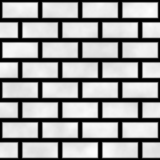
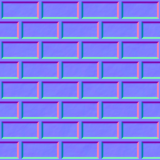

# From arrays to GPU textures

The materials leave six colour images and six height fields in NumPy arrays.
This page covers what happens between those arrays and the first frame: where
the random numbers come from, how a height field becomes a normal map, how
the images are packed and uploaded, and how the GPU reads them back.

(guide-randomness)=
## Randomness and draw order

{py:func}`textures.iter_materials` builds the materials in order:

```{literalinclude} ../../src/textures.py
:language: python
:pyobject: iter_materials
:start-at: if seed is None
:dedent: 4
```

There is one generator, seeded with `config.TEXTURE_SEED` (7), and every
material draws from it in turn, starting where the one before stopped. So
the textures are the same on every run, but each material's numbers depend
on how many the earlier materials drew. At 512 px they draw:

| Layer | Material | Numbers drawn | From |
|---|---|---|---|
| 0 | bricks | 22,373 | five octaves of noise ($9^2 + 17^2 + 33^2 + 65^2 + 129^2$), then the $8 \times 6$ shade table |
| 1 | cobbles | 22,445 | 40 points (80 numbers), then five octaves of noise, then 40 shades |
| 2 | tiles | 0 | |
| 3 | weave | 0 | |
| 4 | rivets | 13,165 | 512 streaks, then five octaves of noise from 6 cells ($7^2 + 13^2 + 25^2 + 49^2 + 97^2$) |
| 5 | wood | 864 | 5 plank offsets, then four octaves of noise from 3 cells ($4^2 + 7^2 + 13^2 + 25^2$) |

An octave with $c$ cells draws $(c + 1)^2$ numbers, one per lattice corner,
whatever the image size.

The consequence: **changing how many numbers one material draws changes every
material after it**, even though their code is untouched. Two examples from
the code:

- The bricks' shade table is $8 \times 6$, `columns + 2`. A staggered row
  reaches column index 4, so only 5 columns are ever read, but drawing 5
  instead of 6 would shift every number that cobbles, rivets and wood
  receive.
- The rivets draw one streak per pixel row, so changing
  `config.TEXTURE_SIZE` changes how many they draw, and with it the wood
  grain.

Giving each material its own generator would remove this coupling, at the
price of changing every texture once. {py:func}`textures.generate_texture_layers`
uses the same function, so the guide's images and the program's textures come
from the same numbers:

```{literalinclude} ../../src/textures.py
:language: python
:pyobject: generate_texture_layers
:start-at: colors, heights = [], []
:dedent: 4
```

It keeps only each material's colour and height. A material's recorded steps
are freed once the next material has been built, so at most two materials'
steps are in memory at a time.

(guide-normal-maps)=
## Normal maps from height: `height_to_normals`

The cube's faces are flat, and the GPU lights a surface by the direction it
faces, its **normal**. To make a flat face light as if it were bumpy, the
fragment shader needs, at every point, the normal the bumpy surface would
have there. A **normal map** stores that normal in the colour channels of a
texture.

The normals are stored in **tangent space**, the face's own frame: $x$ along
the tangent (the direction of $u$), $y$ along the bitangent (the direction of
$v$) and $z$ along the face's normal. A flat spot is $(0, 0, 1)$. Because the
frame belongs to the face, one normal map works whichever way the face is
turned; the shader converts to world space later.

### The maths

Treat the height field as a surface that rises $k\,h(u, v)$ above the face,
with $k$ = `config.BUMP_STRENGTH` = 0.03. Moving a small step along $u$ or
$v$ on that surface moves along

$$
\mathbf{t}_u = (1,\ 0,\ k\,\partial h/\partial u), \qquad
\mathbf{t}_v = (0,\ 1,\ k\,\partial h/\partial v),
$$

and the normal is perpendicular to both:

$$
\mathbf{n} = \operatorname{normalize}\!\left(
  -k\,\frac{\partial h}{\partial u},\ -k\,\frac{\partial h}{\partial v},\ 1
\right).
$$

Check: $\mathbf{n} \cdot \mathbf{t}_u = -k\,\partial h/\partial u +
k\,\partial h/\partial u = 0$, and the same for $\mathbf{t}_v$. A surface
rising towards $+u$ gets a normal leaning towards $-u$, back down the slope.

This uses only the fact that the tangent, bitangent and normal are unit
vectors at right angles. It does not matter whether tangent $\times$
bitangent points out of the face or into it, which is why the mirrored faces
({ref}`how u and v land on the cube <guide-uv-on-cube>`) light correctly.

### The code

```{literalinclude} ../../src/textures.py
:language: python
:pyobject: height_to_normals
:start-at: slope_v, slope_u = np.gradient
:dedent: 4
```

`np.gradient` returns the slope along each array axis, rows first. Rows run
along $v$ and columns along $u$, so the first result is the slope along $v$.
Inside the image each slope is a central difference,
$(h_{i+1} - h_{i-1})/2$; at the border it is one-sided. Both are measured
per pixel.

One pixel is $1/\mathrm{size}$ of a texture unit, so a per-pixel slope times
`size` is the slope per texture unit. That is why the scale is
`BUMP_STRENGTH * height.shape[0]`: it turns the pixel slope into
$k\,\partial h/\partial u$, so the relief is the same at any `TEXTURE_SIZE`.
In world units, a face is 2 wide, so a height of 1 lights like a bump
$2 \times 0.03 = 0.06$ high.

`np.dstack` builds the vectors, dividing by `np.linalg.norm` makes them unit
length, and the last line maps each component from $[-1, 1]$ to $[0, 1]$ so it
can be stored as a colour:

$$
\mathrm{rgb} = \tfrac{1}{2}\,\mathbf{n} + \tfrac{1}{2} .
$$

A flat spot, $(0, 0, 1)$, becomes $(0.5, 0.5, 1)$, the pale blue that fills
most normal maps. Red shows the lean along $u$ and green the lean along $v$.

```{list-table}

* - 

    brick height
  - 

    its normal map
```

Each edge of a brick has its own colour because its bevel leans a different
way: towards $\pm u$ on the short ends, $\pm v$ on the long sides. The noise
on the brick faces tilts the normals a little, which shows as a faint mottle.

(guide-packing)=
## Packing: `to_rgba_bytes`

OpenGL takes texture data as a block of bytes.
{py:func}`textures.to_rgba_bytes` makes one from a list of float images:

```{literalinclude} ../../src/textures.py
:language: python
:pyobject: to_rgba_bytes
:start-at: rgb = np.clip
:dedent: 4
```

- `np.stack` puts the six images into one array of shape
  $(6, 512, 512, 3)$, layer first.
- Values are clipped to $[0, 1]$ and an alpha channel of 1 (opaque) is added,
  giving four channels: RGBA.
- Each value is scaled to 0–255. Adding 0.5 before `astype(np.uint8)`, which
  truncates, rounds to the nearest byte.
- `tobytes()` writes the array in C order: channel varies fastest, then
  column ($u$), then row ($v$), then layer. That is the order OpenGL reads a
  2D array texture: texels along a row, rows up the image, then layers.

The colour images and the normal maps are packed separately. Each block is
$512 \times 512 \times 4 \times 6$ bytes, 6 MiB.

OpenGL calls row 0 the bottom of a texture, while the images in this manual
draw row 0 at the top. Nothing is flipped: row 0 has $v = 0$, and the
vertices give the texture coordinate $v = 0$ to the corner where the
bitangent coordinate is −1 (see {ref}`how u and v land on the cube <guide-uv-on-cube>`), so each face shows
the texture as the materials define it.

(guide-texture-arrays)=
## Texture arrays: `upload_texture_array`

{py:func}`gl_utils.upload_texture_array` creates one **2D array texture**
from a packed block:

```{literalinclude} ../../src/gl_utils.py
:language: python
:pyobject: upload_texture_array
:start-at: GL.glActiveTexture
:dedent: 4
```

A 2D array texture is a stack of same-sized 2D images, called layers, behind
one texture name. A shader reads it with three coordinates, $(u, v, \ell)$:
$u$ and $v$ are filtered as for any 2D texture, but the layer $\ell$ is
rounded to the nearest whole number and never blended. So the six faces can
share one texture, drawn by one `glDrawArrays` call, and filtering never
mixes one face's texture into another's. The alternative of packing all six
images side by side into one large texture (an atlas) leaks colour across
tile borders when the GPU filters or builds mipmaps.

The calls, in order:

- `glActiveTexture(GL_TEXTURE0 + unit)` chooses a **texture unit**, one of
  the numbered slots the shaders read textures from.
- `glGenTextures` and `glBindTexture(GL_TEXTURE_2D_ARRAY, ...)` create the
  texture and attach it to that unit.
- `glTexImage3D` allocates level 0 and copies the bytes in: `GL_RGBA8` is the
  stored format, 8 bits per channel; `size, size, layers` are width, height
  and depth; `GL_RGBA, GL_UNSIGNED_BYTE` describe the bytes passed in.
- `glGenerateMipmap` and the four `glTexParameteri` calls are described in
  the next section.

{py:meth}`cube.CubeRenderer.init_textures` calls it twice and tells the
shader which unit holds which texture:

```{literalinclude} ../../src/cube.py
:language: python
:pyobject: CubeRenderer.init_textures
:start-at: albedo, normals, layers
:dedent: 8
```

The colour images go to unit 0 and the normal maps to unit 1. `glUniform1i`
sets the shader's sampler variables `albedoMap` and `normalMap` to those
unit numbers.

(guide-mipmaps)=
## Mipmaps and filtering

When the cube is small on screen, or a face is seen at a grazing angle, one
screen pixel covers many texels. Reading just one of them picks an
arbitrary sample, and the result flickers as the cube turns: brick joints
appear and vanish. **Mipmaps** fix this. `glGenerateMipmap` builds a chain of
smaller copies of every layer, each half the size of the one before, by
averaging: 512, 256, 128 and so on down to 1, ten levels in all. The chain
adds a third to the memory.

The parameters choose how a texel is read:

- `GL_TEXTURE_MIN_FILTER` is `GL_LINEAR_MIPMAP_LINEAR`, used when texels are
  smaller than pixels. The GPU picks the two levels whose texel size is
  closest to the pixel's footprint, blends the four nearest texels in each
  (bilinear), and blends the two results. This is called trilinear
  filtering.
- `GL_TEXTURE_MAG_FILTER` is `GL_LINEAR`, used when texels are larger than
  pixels: the four nearest texels of level 0 are blended, so the texture
  looks smooth rather than blocky up close.
- `GL_TEXTURE_WRAP_S` and `GL_TEXTURE_WRAP_T` are `GL_CLAMP_TO_EDGE` ($s$ and
  $t$ are OpenGL's names for $u$ and $v$). Each face uses its texture exactly
  once, from 0 to 1. With the default, `GL_REPEAT`, filtering at a face's
  edge would blend in texels from the opposite edge of the texture; clamping
  repeats the edge texel instead.

Averaging encoded normals for the smaller levels gives vectors shorter than 1,
and blending texels does the same at every level. The fragment shader
normalises the normal after decoding it, which restores the length.

## Which layer each vertex uses

Each face of the cube reads its own layer of the two textures, chosen by a
per-vertex attribute; [the geometry page](geometry.md) explains it under
{ref}`guide-layers`.
