# The materials

Each material is a function `material(size, rng)` that returns a
{py:class}`textures.Material`: a colour image, a height field (1 is highest),
and `steps`, the intermediate arrays in the order they were built. The images
on this page are those steps, taken from the real layers by
{py:func}`textures.iter_materials`, followed by the material's normal map
({ref}`guide-normal-maps`) and the finished face as the program draws it.

The materials appear here in the order of `textures.MATERIALS`, which is also
the order of the texture layers and of the faces in
{py:func}`geometry.cube_vertices`. The step images are in texture space, $u$
to the right and $v$ down, and the face image shows the same texture through
that face's tangent and bitangent, so it is turned and sometimes mirrored
({ref}`how u and v land on the cube <guide-uv-on-cube>`).

All six follow one plan:

1. lay out cells with a pattern from the [previous page](primitives.md);
2. make a soft mask of where the gaps between cells are;
3. vary the cells with random shades and fractal noise;
4. `mix` a gap colour and a cell colour by the mask;
5. build the height from the mask, with a little noise on top.

The colours below are linear RGB triples from 0 to 1, copied from the code.

(guide-bricks)=
## Bricks (layer 0, +X)

A staggered wall of red bricks with grey mortar set back from the faces.

```{literalinclude} ../../src/textures.py
:language: python
:pyobject: bricks
:start-at: u, v = uv_grid(size)
:dedent: 4
```

- **distance to edge.** An 8-row by 4-column lattice with every odd row
  shifted by half a brick, and {py:func}`textures.edge_distance` from each
  pixel to the edge of its brick, in texture units. It is at most
  $0.5/8 = 0.0625$.
- **mortar mask.** $m = \operatorname{smoothstep}(0.008, 0.02, d)$: 0 in the
  mortar, 1 on a brick face. A pixel is pure mortar within 0.008 of an edge,
  about 4 pixels at 512 px, so a joint is about 8 pixels wide before the ramp.
- **surface noise.** `fractal_noise` with 8 cells in its first octave, finer
  than the default of 4 to suit a brick-sized grain.
- **brick shade.** One random number per brick. `rng.random((rows, columns +
  2))` draws an 8 by 6 table and the brick's `row` and `column` index it, so
  every pixel of a brick reads the same entry.
- **brick colour.** $\operatorname{mix}(\text{dark}, \text{light},\
  0.6\,\mathrm{shade} + 0.4\,\mathrm{noise})$ between `[0.62, 0.22, 0.16]`
  and `[0.80, 0.36, 0.24]`. The shade makes bricks differ from each other; the
  noise mottles each one.
- **colour.** $\operatorname{mix}(\text{mortar}, \text{brick}, m)$ with mortar
  `[0.62, 0.60, 0.55]`.
- **height.** $m\,(0.85 + 0.15\,\mathrm{noise})$: 0 in the mortar, between
  0.85 and 1 on the bricks. The ramp of the mask becomes a bevel on each
  brick edge, and the noise roughens the faces.

```{list-table}
:widths: 25 25 25 25
:width: 100%

* - 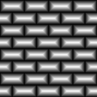

    1: distance to edge

    (stretched)
  - 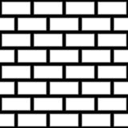

    2: mortar mask
  - 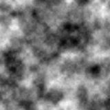

    3: surface noise
  - 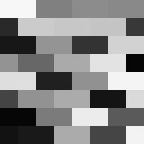

    4: brick shade
* - 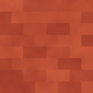

    5: brick colour
  - 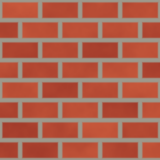

    6: colour
  - 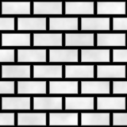

    7: height
  - 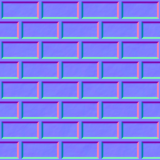

    normal map
* - 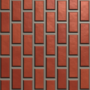

    on the cube
  -
  -
  -
```

(guide-cobbles)=
## Cobbles (layer 1, −X)

Irregular stones in dark mortar. Stones have no grid, so the cells come from
{py:func}`textures.voronoi` around 40 random points.

```{literalinclude} ../../src/textures.py
:language: python
:pyobject: cobbles
:start-at: u, v = uv_grid(size)
:dedent: 4
```

- **distance gap.** 40 seed points drawn uniformly in $[0, 1)^2$, and the
  Voronoi gap $d_{(2)} - d_{(1)}$: 0 on the border between two stones and
  larger towards a stone's middle. Here it reaches about 0.21.
- **mortar mask.** $m = \operatorname{smoothstep}(0, 0.05, \mathrm{gap})$.
  The ramp is wide compared with the bricks', so the stones get broad rounded
  shoulders instead of a narrow bevel.
- **surface noise.** `fractal_noise` with 8 cells in its first octave.
- **stone shade.** One random number per stone, indexed by `nearest`, the
  stone each pixel belongs to.
- **stone colour.** $\operatorname{mix}(\text{grey}, \text{pale},\
  0.7\,\mathrm{shade} + 0.3\,\mathrm{noise})$ between `[0.42, 0.42, 0.44]`
  and `[0.72, 0.70, 0.66]`.
- **colour.** $\operatorname{mix}(\text{mortar}, \text{stone}, m)$ with the
  dark mortar `[0.16, 0.14, 0.12]`.
- **height.** $m\,(0.8 + 0.2\,\mathrm{noise})$.

```{list-table}
:widths: 25 25 25 25
:width: 100%

* - 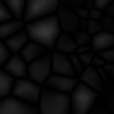

    1: distance gap

    (stretched)
  - 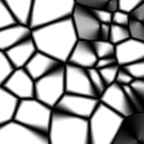

    2: mortar mask
  - 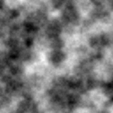

    3: surface noise
  - 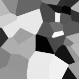

    4: stone shade
* - 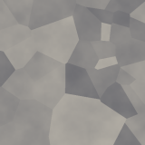

    5: stone colour
  - 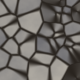

    6: colour
  - 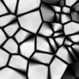

    7: height
  - 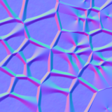

    normal map
* - 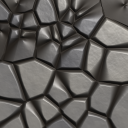

    on the cube
  -
  -
  -
```

(guide-tiles)=
## Tiles (layer 2, +Y)

A 4 by 4 checkerboard of glazed teal and cream tiles with bevelled edges and
recessed grout. Nothing in it is random; the function still takes `rng` so
every material has the same signature.

```{literalinclude} ../../src/textures.py
:language: python
:pyobject: tiles
:start-at: u, v = uv_grid(size)
:dedent: 4
```

- **distance to edge.** `edge_distance` on a plain 4 by 4 lattice, at most
  $0.5/4 = 0.125$.
- **grout mask.** $m = \operatorname{smoothstep}(0.004, 0.03, d)$. The grout
  is flat within 0.004 of an edge, about 2 pixels; the ramp from 0.004 to
  0.03, about 13 pixels, is the bevel.
- **checker.** `checker(column, row)`: 0 and 1 alternating.
- **glaze.** $\operatorname{mix}(\text{teal}, \text{cream},
  \mathrm{checker})$ between `[0.10, 0.48, 0.50]` and `[0.82, 0.86, 0.80]`.
- **colour.** $\operatorname{mix}(\text{grout}, \text{glaze},\
  \operatorname{smoothstep}(0, 0.3, m))$ with grout `[0.30, 0.28, 0.26]`.
  The colour reaches the glaze where the mask reaches 0.3, low on the
  bevel, so most of the bevel is glazed and only the lighting shows its
  slope.
- **height.** The grout mask itself.

```{list-table}
:widths: 25 25 25 25
:width: 100%

* - 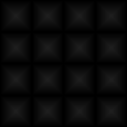

    1: distance to edge

    (stretched)
  - 

    2: grout mask
  - 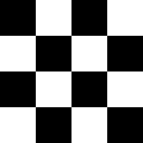

    3: checker
  - 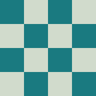

    4: glaze
* - 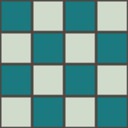

    5: colour
  - 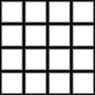

    6: height
  - 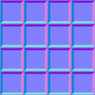

    normal map
  - 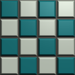

    on the cube
```

(guide-weave)=
## Weave (layer 3, −Y)

A basket weave of straw strands, one strand per cell on a 10 by 10 lattice.
Strands run alternately across (along $u$) and along (along $v$), and in each
cell one of them is on top. Like the tiles, it uses no randomness.

```{literalinclude} ../../src/textures.py
:language: python
:pyobject: weave
:start-at: u, v = uv_grid(size)
:dedent: 4
```

- **over or under.** `checker(column, row) == 0`: 1 where the strand running
  across is on top, 0 where the strand running along is.
- **strands across.** The height of a strand running along $u$:

  $$
  h_{\text{across}} = \sin(\pi f_y)\,\bigl(0.55 + 0.45 \sin(\pi f_x)\bigr) .
  $$

  $\sin(\pi f_y)$ is an arch across the strand's width, 0 at its sides and 1
  in its middle. The second factor lowers its ends to 0.55 of the peak, where
  the strand dips to pass under its neighbour.
- **strands along.** The same with $f_x$ and $f_y$ swapped: a strand running
  along $v$.
- **height.** `np.where(over, across, along)`: in each cell, the strand on
  top.
- **colour.** $\operatorname{mix}(\text{dark}, \text{straw},\ h)$ between
  `[0.30, 0.22, 0.10]` and `[0.86, 0.72, 0.42]`. The colour is made from the
  height, so this material records height before colour. The low parts,
  where one strand passes under another, come out dark.

```{list-table}
:widths: 25 25 25 25
:width: 100%

* - 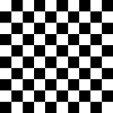

    1: over or under
  - 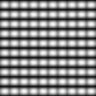

    2: strands across
  - 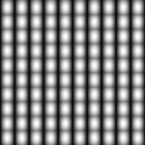

    3: strands along
  - 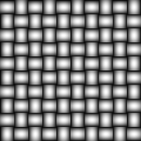

    4: height
* - 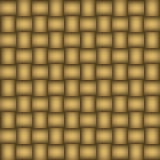

    5: colour
  - 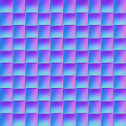

    normal map
  - 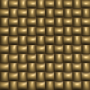

    on the cube
  -
```

(guide-rivets)=
## Rivets (layer 4, +Z)

A brushed metal plate with a 5 by 5 grid of domed rivets.

```{literalinclude} ../../src/textures.py
:language: python
:pyobject: rivets
:start-at: u, v = uv_grid(size)
:dedent: 4
```

- **dome.** `dome(fx - 0.5, fy - 0.5, 0.16)`: a hemisphere of radius 0.16
  cells in the middle of each cell. Only the fractions from
  `cell_lattice` are used; which cell a pixel is in does not matter.
- **brushed streaks.** `rng.random((size, 1))` gives one random number per
  pixel row, and `np.tile` repeats it along the row. The result is constant
  along $u$ and changes from row to row: fine scratches all running the same
  way, as left by brushing metal in one direction.
- **brushed finish.** $0.5\,\mathrm{streaks} + 0.5\,\mathrm{noise}$, with
  `fractal_noise` starting at 6 cells, so the streaks vary in brightness
  over larger patches.
- **plate colour.** $\operatorname{mix}(\text{dark}, \text{light},\
  \mathrm{brushed})$ between the blue-greys `[0.42, 0.44, 0.48]` and
  `[0.62, 0.64, 0.68]`.
- **colour.** $\operatorname{mix}(\text{plate}, \text{rivet},
  \mathrm{dome})$ with the rivet colour `[0.74, 0.74, 0.76]`.
- **height.** $0.8\,\mathrm{dome} + 0.04\,\mathrm{brushed}$. The rivets
  stand well out. The brushing adds only a faint ripple in height, but it
  changes from one pixel row to the next, so its slope, which is what the
  lighting responds to, is steep enough to show.

```{list-table}
:widths: 25 25 25 25
:width: 100%

* - 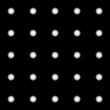

    1: dome
  - 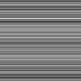

    2: brushed streaks
  - 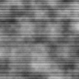

    3: brushed finish
  - 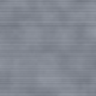

    4: plate colour
* - 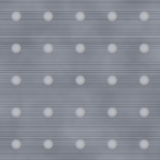

    5: colour
  - 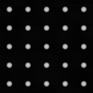

    6: height
  - 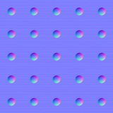

    normal map
  - 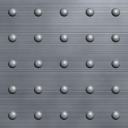

    on the cube
```

(guide-wood)=
## Wood (layer 5, −Z)

Five planks with a wavy grain, separated by dark gaps. The planks run along
$v$, so this material needs only a one-dimensional lattice, written inline.

```{literalinclude} ../../src/textures.py
:language: python
:pyobject: wood
:start-at: u, v = uv_grid(size)
:dedent: 4
```

- **plank offset.** `plank = floor(5u)` numbers the planks and
  $x = 5u - \mathrm{plank}$ is the position across one, in plank widths. Each
  plank gets one random offset from `rng.random(5)`.
- **grain wobble.** `fractal_noise` with 3 cells and 4 octaves: broad, gentle
  variation to bend the grain.
- **grain.** Stripes from a sine wave:

  $$
  g = 0.5 + 0.5 \sin\!\bigl(38\,(x + 0.5\,w + o) + 3v\bigr),
  $$

  with $w$ the wobble and $o$ the offset. The phase grows by 38 radians
  across a plank, about six stripes. Adding $0.5\,w$ bends them, adding $o$
  shifts each plank's stripes so neighbours do not line up, and $3v$ tilts
  them slightly.
- **plank gap.** $\operatorname{smoothstep}(0, 0.03, \operatorname{seam}(x))$:
  0 at a plank edge, 1 from 0.03 plank widths in, a dark groove about 6
  pixels wide in all at 512 px.
- **wood colour.** $\operatorname{mix}(\text{dark}, \text{light},\
  g\,(0.6 + 0.4\,o))$ between `[0.36, 0.20, 0.09]` and
  `[0.68, 0.45, 0.24]`. The offset also scales the weight, so planks differ
  in overall tone.
- **colour.** $\operatorname{mix}(\text{gap}, \text{wood}, \mathrm{gap})$
  with the gap colour `[0.08, 0.05, 0.03]`.
- **height.** $\mathrm{gap}\,(0.85 + 0.15\,g)$: the grooves are low and the
  grain stands out slightly.

```{list-table}
:widths: 25 25 25 25
:width: 100%

* - 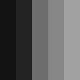

    1: plank offset
  - 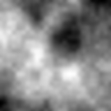

    2: grain wobble
  - 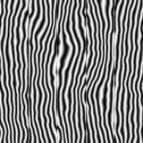

    3: grain
  - 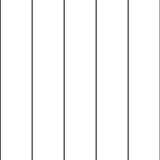

    4: plank gap
* - 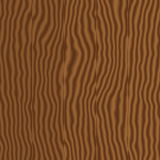

    5: wood colour
  - 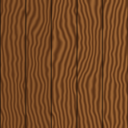

    6: colour
  - 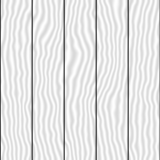

    7: height
  - 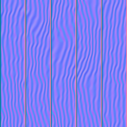

    normal map
* - 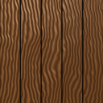

    on the cube
  -
  -
  -
```
