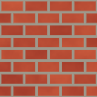
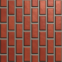

# Primitives and patterns

A material is a function from a position on the face to a colour and a
height. NumPy evaluates it for every pixel of a 512 by 512 image at once
(`config.TEXTURE_SIZE`), so each building block below takes and returns whole
arrays. Five primitives do the numerical work; six patterns built from them
are shared between the materials.

The shader code later in this chapter uses the same ideas: GLSL has built-in
`smoothstep` and `mix` functions with the same definitions as the NumPy ones
here.

## Texture coordinates: `uv_grid`

{py:func}`textures.uv_grid` gives every pixel a position $(u, v)$, with both
coordinates running from 0 to just under 1 across the image:

```{literalinclude} ../../src/textures.py
:language: python
:pyobject: uv_grid
:start-at: v, u = np.mgrid
:dedent: 4
```

`np.mgrid` returns the row index $i$ and the column index $j$ of every pixel,
so the pixel in row $i$ and column $j$ gets

$$
u = \frac{j}{\mathrm{size}}, \qquad v = \frac{i}{\mathrm{size}} .
$$

$u$ grows along a row, to the right in the images; $v$ grows down the rows.
Both run from 0 to $(\mathrm{size} - 1)/\mathrm{size}$, just short of 1.

Writing the materials in $u$ and $v$ instead of pixel indices keeps them
independent of the resolution: "eight rows of bricks" means $v \cdot 8$,
whatever `TEXTURE_SIZE` is.

(guide-uv-on-cube)=
### How $u$ and $v$ land on the cube

The images in this chapter show the textures as stored, with $u$ to the right
and $v$ down. On the cube, each face carries its own pair of axes, set in
{py:func}`geometry.cube_vertices`:

```{literalinclude} ../../src/geometry.py
:language: python
:pyobject: cube_vertices
:start-at: for layer
:dedent: 4
```

The loop runs over `geometry.CUBE_FACES`, quoted with the rest of the
function on {ref}`the geometry page <guide-cube-faces>`.

For a face whose normal lies along axis `axis`, the other two axes, in
increasing order, become the **tangent** (the direction in which $u$ grows)
and the **bitangent** (the direction in which $v$ grows). The four corners
sit at $a, b = \pm 1$ along those two axes, and get the texture coordinates
$u = (a + 1)/2$ and $v = (b + 1)/2$, so the whole texture covers the face once.

| Layer | Face | Material | Tangent ($u$) | Bitangent ($v$) |
|---|---|---|---|---|
| 0 | +X | bricks | +Y | +Z |
| 1 | −X | cobbles | +Y | +Z |
| 2 | +Y | tiles | +X | +Z |
| 3 | −Y | weave | +X | +Z |
| 4 | +Z | rivets | +X | +Y |
| 5 | −Z | wood | +X | +Y |

So a texture is rotated or flipped on the cube compared with its picture
here. The brick wall below has its courses running along $u$, left to right.
The +X face's tangent is +Y, so on the cube the courses run along +Y. In
`face-bricks.png`, which views the +X face from outside with +Y up, $u$ runs
up the picture and $v$ runs to the left, and the bricks stand on end:

```{list-table}
:header-rows: 1

* - In texture space
  - On the +X face
* - 
  - 
```

The faces also differ from the pictures in handedness. A picture puts $v$
downwards, 90° clockwise from $u$. On +X, −Y and +Z,
$\mathrm{tangent} \times \mathrm{bitangent}$ points outwards, so seen from
outside $v$ runs 90° anticlockwise from $u$, as $y$ does from $x$ on a graph:
those faces show the picture mirrored as well as turned. On −X, +Y and −Z it
points inwards, and the picture is only turned. None of the six materials has
a handedness that would make this visible, and the lighting is correct either
way ({ref}`guide-normal-maps`).

## Soft thresholds: `smoothstep`

Most material steps ask a yes-or-no question: is this pixel mortar or brick?
Answering it with a hard threshold, `x > c`, makes each pixel either 0 or 1,
and the boundary becomes a staircase of whole pixels. {py:func}`textures.smoothstep`
answers with a ramp instead:

```{literalinclude} ../../src/textures.py
:language: python
:pyobject: smoothstep
:start-at: t = np.clip
:dedent: 4
```

$$
t = \operatorname{clamp}\!\left(\frac{x - \mathrm{low}}{\mathrm{high} - \mathrm{low}},\ 0,\ 1\right),
\qquad
\operatorname{smoothstep}(x) = t^2 (3 - 2t) = 3t^2 - 2t^3 .
$$

Below `low` the result is 0, above `high` it is 1, and in between it rises
along an S-curve. Its slope, $6t - 6t^2$, is zero at both ends, so the ramp
joins the flat parts without a kink.

```{figure} ../images/guide/smoothstep.png
:alt: A horizontal greyscale ramp, black on the left and white on the right

`smoothstep(0.3, 0.7, u)`: black for $u < 0.3$, white for $u > 0.7$, an
S-shaped ramp between.
```

The soft edge matters in three places.

- **Antialiasing.** A boundary spread over a few pixels has no staircase.
  The thresholds are chosen in texture units to cover a few pixels at 512 px;
  the brick mortar, for example, ramps over $0.02 - 0.008 = 0.012$ of the
  texture, about 6 pixels.
- **Mipmaps.** The GPU stores halved copies of each texture and blends between
  them for distant faces ({ref}`guide-mipmaps`). A ramp
  several texels wide shrinks into a narrower ramp; a one-texel step shrinks
  into a blur whose shape depends on where the step fell.
- **Normal maps.** The lighting reads the slope of the height field. A hard
  step has one column of very steep slope and none elsewhere, which lights as
  a thin bright or dark line. A ramp has a definite slope over its width,
  which lights as a bevel.

## Blending: `mix`

{py:func}`textures.mix` is linear interpolation, the same operation as GLSL's
`mix`:

```{literalinclude} ../../src/textures.py
:language: python
:pyobject: mix
:start-at: a, b = np.asarray
:dedent: 4
```

$$
\operatorname{mix}(a, b, t) = a\,(1 - t) + b\,t .
$$

Where the mask $t$ is 0 the result is $a$, where it is 1 the result is $b$.
$a$ and $b$ may be single RGB colours, 2D fields or RGB images. When either is
a colour or an image, the mask gets a trailing axis of length 1 so NumPy
broadcasts it across the three channels.

```{figure} ../images/guide/mix.png
:alt: A horizontal blend from dark red on the left to lighter orange-red on the right

`mix` of the two brick reds, `[0.62, 0.22, 0.16]` and `[0.80, 0.36, 0.24]`,
by the smoothstep ramp above.
```

## Value noise: `value_noise`

Real surfaces vary: no two bricks are the same shade, and stone is mottled.
Noise supplies that variation. It must be random, but smooth, so neighbouring
pixels are related. {py:func}`textures.value_noise` makes it by placing random
values on a coarse lattice and interpolating between them:

```{literalinclude} ../../src/textures.py
:language: python
:pyobject: value_noise
:start-at: grid = rng.random
:dedent: 4
```

1. `grid` holds $(\mathrm{cells} + 1)^2$ random values in $[0, 1)$, one at
   each lattice corner.
2. Pixel $j$ along a side sits at lattice position
   $p_j = j \cdot \mathrm{cells} / \mathrm{size}$. Its integer part
   $k = \lfloor p_j \rfloor$ names the lattice cell, and $f = p_j - k$ is the
   position inside it.
3. The fraction is faded, $f \leftarrow 3f^2 - 2f^3$, the same curve as
   `smoothstep`.
4. The four corners of the cell are blended, first along $u$ (`top` and
   `low`), then along $v$:

$$
n = \bigl[g_{k_v, k_u}(1 - f_u) + g_{k_v, k_u + 1} f_u\bigr](1 - f_v)
  + \bigl[g_{k_v + 1, k_u}(1 - f_u) + g_{k_v + 1, k_u + 1} f_u\bigr] f_v .
$$

Without the fade in step 3 this is plain bilinear interpolation, whose slope
jumps at every lattice line. The jumps are faint in the colour but obvious in
a normal map, which is built from the slope. The faded fraction has zero slope
at $f = 0$ and $f = 1$, so the slope is continuous across cell borders.

Each result is a weighted average of four values in $[0, 1)$, so it stays in
that range.

```{figure} ../images/guide/noise-octave.png
:alt: Soft grey blobs on a four by four lattice

One octave with 4 cells per side: smooth, but too regular and blobby to pass
for a surface.
```

## Fractal noise: `fractal_noise`

{py:func}`textures.fractal_noise` adds several octaves of value noise. Each
octave has twice as many cells as the one before, so its features are half the
size, and half the amplitude:

```{literalinclude} ../../src/textures.py
:language: python
:pyobject: fractal_noise
:start-at: total = np.zeros
:dedent: 4
```

$$
\mathrm{total} = \sum_{k=0}^{K-1} 2^{-k}\, N_{c \cdot 2^k},
\qquad
\mathrm{fractal} = \frac{\mathrm{total} - \min(\mathrm{total})}{\max(\mathrm{total}) - \min(\mathrm{total})},
$$

where $N_c$ is one octave with $c$ cells per side. With the defaults
$c = 4$ and $K = 5$ the octaves have 4, 8, 16, 32 and 64 cells. The coarse
octaves set the large shapes and the fine ones add grain, as in many natural
surfaces. The last line rescales the sum to exactly 0 to 1 (`np.ptp` is the
range, max minus min), so the materials can use it directly as a blend weight.

```{figure} ../images/guide/noise-fractal.png
:alt: Cloudy greyscale noise with detail at several scales

Five octaves starting at 4 cells, normalised to 0 to 1.
```

The primitive and pattern images use their own generator (seed 1 in
`tools/make_guide_images.py`), so they differ from the noise inside the
materials, which comes from `config.TEXTURE_SEED`.

## Shared patterns

Six patterns turn $(u, v)$ into the shapes the materials are made of. Each is
a few lines; each is used by at least one material.

### `cell_lattice`

{py:func}`textures.cell_lattice` divides the texture into `columns` by `rows`
cells, and tells each pixel which cell it is in and where inside it:

```{literalinclude} ../../src/textures.py
:language: python
:pyobject: cell_lattice
:start-at: scaled_v = v * rows
:dedent: 4
```

$$
\mathrm{row} = \lfloor v \cdot \mathrm{rows} \rfloor, \quad
x = u \cdot \mathrm{columns} + \mathrm{stagger} \cdot (\mathrm{row} \bmod 2), \quad
\mathrm{column} = \lfloor x \rfloor,
$$

$$
f_x = x - \mathrm{column}, \qquad f_y = v \cdot \mathrm{rows} - \mathrm{row} .
$$

Scaling makes each cell one unit wide and tall; the integer part is the cell,
the fractional part $(f_x, f_y)$ the position inside it, from 0 up to 1. A
`stagger` of 0.5 shifts every odd row by half a cell, which is running-bond
brickwork. A staggered row then shows parts of `columns + 1` cells, so
`column` can reach `columns`.

```{figure} ../images/guide/pattern-cell-lattice.png
:alt: Rows of horizontal ramps, each restarting at every brick, offset by half a brick on alternate rows

$f_x$ for 4 columns, 8 rows and a stagger of 0.5, the brick layout. Each ramp
runs black to white across one cell.
```

### `seam`

{py:func}`textures.seam` measures how far a position inside a cell is from the
nearer of its two edges:

```{literalinclude} ../../src/textures.py
:language: python
:pyobject: seam
:start-at: return np.minimum
:dedent: 4
```

$$
\operatorname{seam}(f) = \min(f,\ 1 - f) .
$$

It is a triangle wave: 0 at both edges, 0.5 in the middle, in cell widths.
Thresholding it with `smoothstep` gives a gap of fixed width along every
cell edge.

```{figure} ../images/guide/pattern-seam.png
:alt: Five vertical bands, each dark at its edges and mid grey in its middle

`seam` of the fraction of $5u$: five strips, as for the wood planks. Its
maximum is 0.5, so the centre of each strip is mid grey.
```

### `edge_distance`

Bricks and tiles need a border on all four sides of a cell.
{py:func}`textures.edge_distance` takes the seam along each axis and converts
both to texture units before taking the smaller:

```{literalinclude} ../../src/textures.py
:language: python
:pyobject: edge_distance
:start-at: return np.minimum
:dedent: 4
```

$$
d = \min\!\left(\frac{\operatorname{seam}(f_x)}{\mathrm{columns}},\
                \frac{\operatorname{seam}(f_y)}{\mathrm{rows}}\right) .
$$

The division matters for cells that are not square. A brick is $1/4$ of the
texture wide and $1/8$ tall, so 0.1 of a brick's width is 0.025 texture units
but 0.1 of its height is only 0.0125. Measured in texture units, one
threshold gives mortar of equal thickness on every side. The largest value,
at a cell centre, is $0.5 / \max(\mathrm{columns}, \mathrm{rows})$: 0.0625
for the bricks.

```{figure} ../images/guide/pattern-edge-distance.png
:alt: Staggered bricks, each black at its border and brightening to a ridge along its middle

`edge_distance` on the brick lattice (**stretched**: its maximum is 0.0625).
Each brick rises like a hipped roof to a ridge along its long middle line.
```

### `checker`

{py:func}`textures.checker` alternates between 0 and 1 like a chessboard:

```{literalinclude} ../../src/textures.py
:language: python
:pyobject: checker
:start-at: return (column + row)
:dedent: 4
```

Moving one cell in either direction changes $\mathrm{column} + \mathrm{row}$
by one, which flips its parity. The result stays a float so `mix` can use it
as a blend weight.

```{figure} ../images/guide/pattern-checker.png
:alt: A four by four black and white checkerboard

`checker` on a 4 by 4 lattice, the tile layout.
```

### `voronoi`

Cobblestones are irregular, so they cannot come from a lattice.
{py:func}`textures.voronoi` scatters seed points $q_k$ and gives each pixel
to the nearest one; the pixels that share a nearest point form one stone, a
Voronoi cell.

```{literalinclude} ../../src/textures.py
:language: python
:pyobject: voronoi
:start-at: distance = np.hypot
:dedent: 4
```

With $d_{(1)} \le d_{(2)}$ the two smallest of the distances
$\lVert (u, v) - q_k \rVert$,

$$
\mathrm{nearest} = \arg\min_k \lVert (u, v) - q_k \rVert, \qquad
\mathrm{gap} = d_{(2)} - d_{(1)} .
$$

On the border between two cells the two nearest points are equally far
away, so the gap is 0; it grows towards the middle of each cell. It is not
exactly the distance to the border, but it is zero on it and rises away from
it, which is all a mortar threshold needs. `np.partition(..., 1, axis=2)`
finds the two smallest distances without sorting all of them.

Every pixel's distance to every point is computed at once: at 512 px with 40
points that is $512 \times 512 \times 40$ values, which is why they are stored
as `float32`.

```{figure} ../images/guide/pattern-voronoi.png
:alt: Irregular polygonal cells with dark borders, bright in their middles

The gap for 40 random points (**stretched**: its maximum is about 0.17).
```

### `dome`

{py:func}`textures.dome` gives the height of a hemisphere, used for the rivet
heads:

```{literalinclude} ../../src/textures.py
:language: python
:pyobject: dome
:start-at: r = np.hypot
:dedent: 4
```

$$
r = \frac{\sqrt{f_x^2 + f_y^2}}{\mathrm{radius}}, \qquad
h = \sqrt{\operatorname{clamp}(1 - r^2,\ 0,\ 1)} .
$$

A unit sphere seen from above has height $\sqrt{1 - r^2}$. Outside the radius
$1 - r^2$ is negative, so it is clamped to 0 and the dome meets a flat floor.
The callers pass $f_x - 0.5$ and $f_y - 0.5$ so the dome sits in the middle of
its cell.

```{figure} ../images/guide/pattern-dome.png
:alt: A five by five grid of small soft white discs on black

`dome` with a radius of 0.16 cells on a 5 by 5 lattice, the rivet layout.
```
